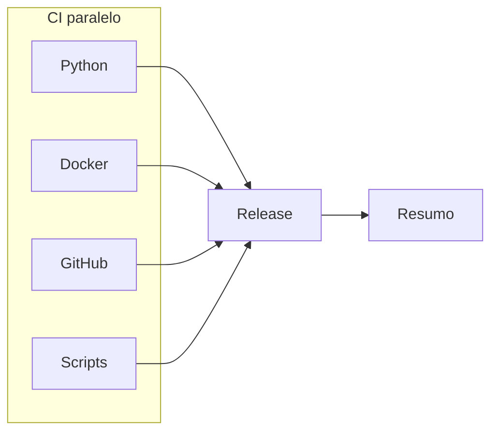

# GitHub Actions

Pipelines de integracao e release da PoC OTRS → Google Chat.

Documentacao completa: [docs/devops.md](../docs/devops.md).

## Visao (push em `main`)



## Matriz por categoria (5 estagios obrigatorios)

Cada categoria (`Python`, `Docker`, `GitHub`, `Scripts`) executa estritamente:

1. `<Categoria> | Lint`
2. `<Categoria> | Seguranca`
3. `<Categoria> | Testes`
4. `<Categoria> | Validate`
5. `<Categoria> | Build`

Orquestrador unico: `python app/scripts/operations/clean_workspace.py --area <python|docker|github|scripts> --stage <lint|security|test|validate|build|clean>`.

## Composite actions

```text
.github/actions/
├── shared/pipeline-summary/
└── ci/
    ├── setup-python/
    ├── validate-docker/
    ├── validate-github/
    ├── validate-scripts/
    ├── release/
    └── sync-tags/
```

## Secrets

| Secret | Uso |
|--------|-----|
| `GITHUB_TOKEN` | Release e sync-tags |
